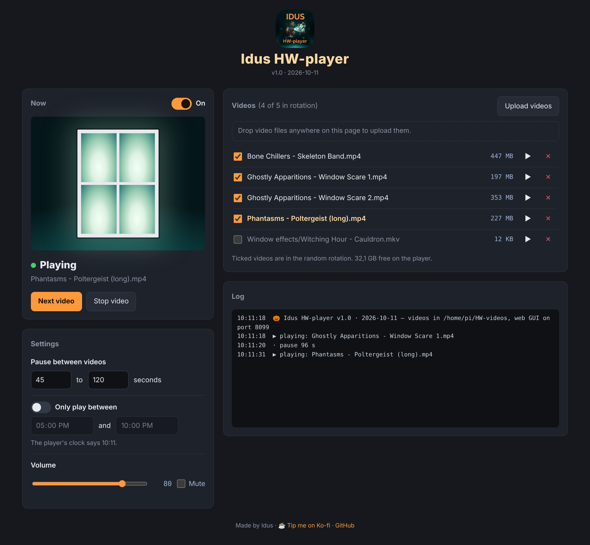
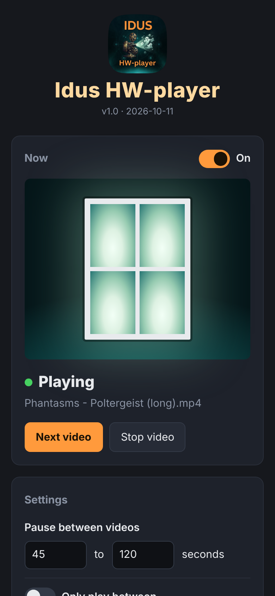

<div align="center">


# Idus Halloween-player

**The Idus Halloween Player — random scares in your window, run from your browser.**

A small player for a Raspberry Pi and a projector (or a TV) that shows random Halloween
videos, like [AtmosFX](https://atmosfx.com) digital decorations, with a random pitch-dark
pause between them, so trick-or-treaters never know when the next ghost shows up.
You run the whole show from a web GUI on your PC or phone.


</div>



<p align="center"><br><sub>Works on a phone too.</sub></p>

## Why

Projecting ghosts onto a window is the best Halloween trick there is, but a DVD loop or a
laptop on repeat plays the scares back-to-back, in the same order, with a desktop or a
mouse pointer flashing in between. Idus HW-player shuffles the videos, keeps the window
black for a random while between scares, plays only during the hours you choose, and
lets you run it all from the sofa, or from the garden on your phone.

## Requirements

- A Raspberry Pi. A **Pi 4 or 5 is preferred** — hardware decode for both H.264 and H.265,
  4K output, and plenty of headroom. A **Pi 3 / 3B works too**, as long as your videos are
  **H.264 1080p**: the Pi 3 has hardware H.264 decode but **no hardware H.265 (HEVC) decode**,
  so HEVC files stutter. Re-encode those to H.264 first (see [Tips](#tips-for-the-window-effect)).
  AtmosFX / AtmosFearFX downloads are H.264, so they play as-is. Any Debian-based Linux works.
- **Raspberry Pi OS Lite** (no desktop) is recommended: the screen stays truly black
  between videos. On a Pi 3 with 1 GB RAM, the **32-bit Lite** image is the leanest choice.
  With a desktop install, the installer offers to boot to console instead.
- A projector or TV on HDMI
- mpv and Python 3.9+ (the installer installs mpv; Python comes with Raspberry Pi OS)

> **Check a file's codec before uploading:**
> `ffprobe -v error -select_streams v:0 -show_entries stream=codec_name,width,height -of csv=p=0 video.mp4`
> → `h264` plays anywhere; `hevc` needs a Pi 4/5 or a re-encode to H.264.

## Install

Download the three files (or grab them from [Releases](../../releases)), put them in one
folder on the Pi, then run as your normal user:

```bash
bash install-idus-hw-player.sh
```

- You choose a password for the web GUI, or press Enter to get a generated one.
- Videos go in `~/HW-videos` by default. Change with
  `HW_VIDEO_DIR=/path bash install-idus-hw-player.sh`
- The web GUI uses port 8080. Change with `HW_PORT=8081 bash install-idus-hw-player.sh`
- At the end the installer prints the address, e.g. `http://192.168.1.50:8080`. Open it on
  your PC or phone, log in (any user name, your password) and upload some videos.
- The player starts on every boot. Run the installer again to update; your password and
  settings are kept.

## What the web GUI does

| Group | Control | Action |
|---|---|---|
| Now | On / Off | Off keeps the window dark until you switch it back on |
| | Play a video now / Next video | Skips the pause, or the video that is playing |
| | Stop video | Stops the current video; the pause starts |
| Settings | Pause between videos | Random pause between the shortest and the longest, in seconds |
| | Only play between | Show hours, e.g. 17:00–22:00 (may span midnight) |
| | Volume / Mute | Applies at once |
| Videos | Upload videos | Pick files, or drag and drop them anywhere on the page (PC). Up to 8 GB each, with progress |
| | Checkbox | Puts the video in or out of the random rotation |
| | ▶ | Plays this video now. Works even when off or outside show hours, handy for testing in daylight |
| | ✕ | Deletes the video from the player |
| Log | | The last 80 events: what played, pauses, uploads, errors |

**Shuffle rule:** every video plays once before any video plays again, and the same video
never plays twice in a row. The video folder is re-read before each video, so you can add
files over the network or with `scp` while the player runs; sub-folders work too.

### CLI

Every action has a flag, for KDE global shortcuts or a Stream Deck:

```bash
idus-hw-player --status | --next | --stop | --on | --off | --list | --version
```

From another machine, add `--host` and the password:

```bash
HW_PASSWORD=yourpassword idus-hw-player --host 192.168.1.50 --next
```

## Configuration

Everything you change day to day is in the web GUI. The rest lives in
`~/.local/share/idus-hw-player/idus-hw-player.env`. Change it, then run
`sudo systemctl restart idus-hw-player`.

| Setting | Default | Meaning |
|---|---|---|
| `HW_PASSWORD` | set by the installer | Web GUI password (any user name) |
| `HW_VIDEO_DIR` | `~/HW-videos` | Where the videos live |
| `HW_PORT` | `8080` | Web GUI port |
| `HW_BIND` | `0.0.0.0` | Address to listen on |
| `HW_MPV_ARGS` | empty | Extra mpv arguments, e.g. `"--audio-device=alsa/hdmi:CARD=vc4hdmi0,DEV=0"` |

App, icon, settings and env file live together in `~/.local/share/idus-hw-player`, so one
folder backup captures everything except the videos.

## Tips for the window effect

- Use the **window versions** of AtmosFX-style videos (black background). Black stays
  see-through on the screen, so the ghosts float in the room.
- Rear projection works best: a translucent projection screen on the inside of the window,
  the projector in the room behind it, a dark room.
- Hide the boot text that shows before the player starts:
  `sudo systemctl disable getty@tty1` (you then log in over SSH only).

## Notes & caveats

- **Security:** the web GUI needs the password, and rejects commands sent from other web
  pages. It is plain `http`, though, so **don't open the port to the internet**. To control
  it from outside your home, use a VPN such as WireGuard or Tailscale.
- **No picture,** or the log says mpv exited right away: make sure no desktop is running
  (`systemctl get-default` should say `multi-user.target`) and reboot. Still nothing? Try
  `HW_MPV_ARGS="--vo=drm"`.
- **No sound:** list the audio devices with `mpv --audio-device=help` and put the right one
  in `HW_MPV_ARGS`.
- **Choppy video:** re-encode to 720p before uploading:
  `ffmpeg -i in.mp4 -vf scale=-2:720 -c:v libx264 -crf 22 -c:a copy out-720p.mp4`
- Live log on the Pi: `journalctl -u idus-hw-player -f`
- The player ships no videos. Not affiliated with AtmosFX.

## Uninstall

```bash
sudo systemctl disable --now idus-hw-player
sudo rm -f /etc/systemd/system/idus-hw-player.service && sudo systemctl daemon-reload
rm -f  ~/.local/bin/idus-hw-player
rm -rf ~/.local/share/idus-hw-player
```

Your videos in `~/HW-videos` are left alone.

## Support

Made by **Idus**. If this made your Halloween a little spookier, buy me a coffee:

<a href='https://ko-fi.com/N4N2QZHKK' target='_blank'></a>

## License

MIT — see [LICENSE](LICENSE).

o7
